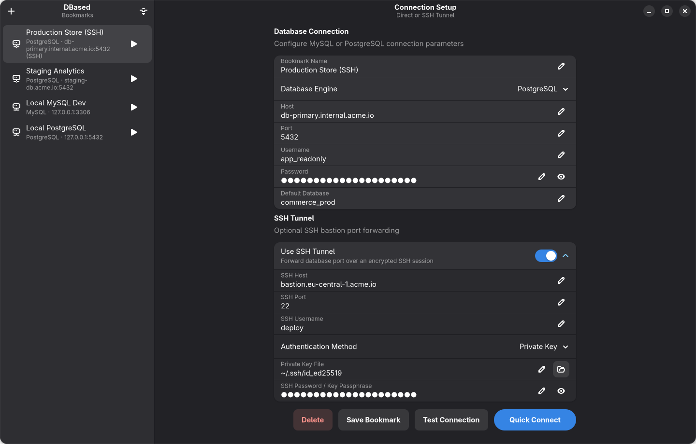
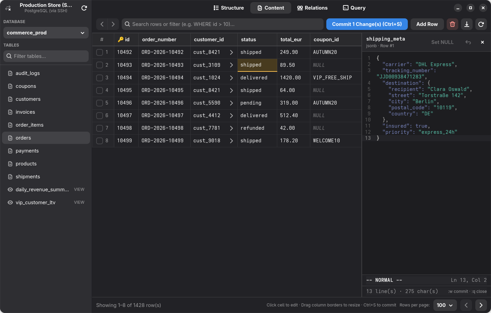
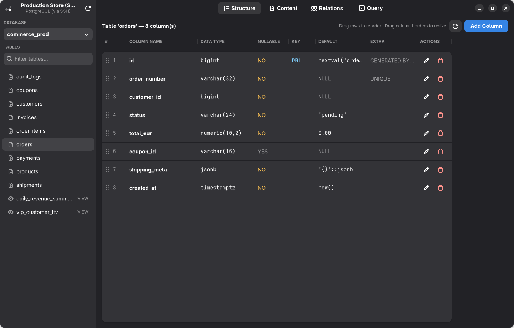
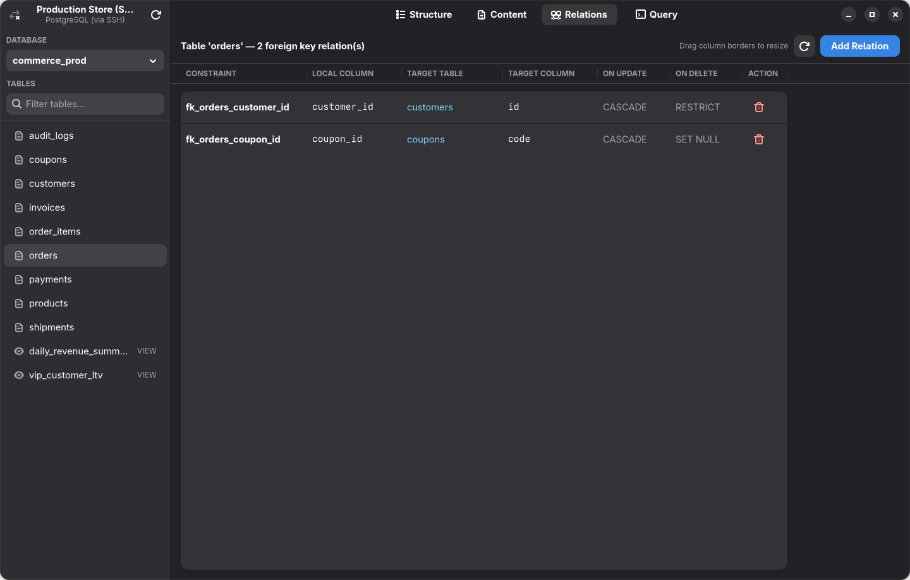
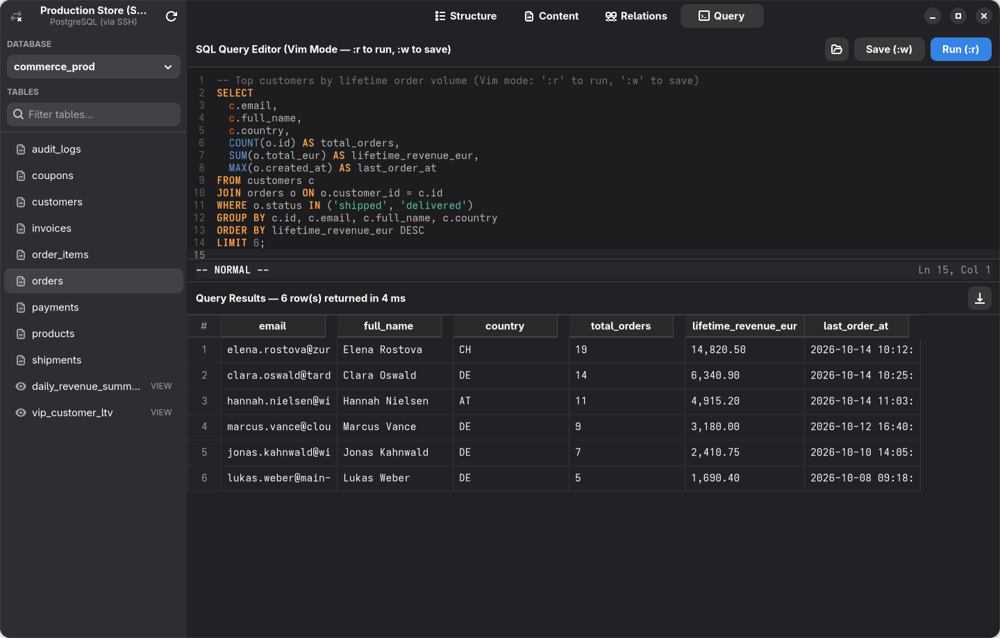

<div align="center">
  
  <h1>DBased</h1>
  <p><strong>A fast, native GTK4 &amp; Libadwaita database client for PostgreSQL and MySQL/MariaDB</strong></p>

  <p>
    <a href="#features">Features</a> •
    <a href="#screenshots">Screenshots</a> •
    <a href="#installation">Installation</a> •
    <a href="#usage--shortcuts">Usage &amp; Shortcuts</a> •
    <a href="#configuration--security">Configuration</a> •
    <a href="#license">License</a>
  </p>
</div>

---

**DBased** is a lightweight, native Linux GUI database client built with **Rust**, **GTK4**, **Libadwaita**, and **GtkSourceView 5**. Designed around a clean GNOME aesthetic and keyboard-centric workflows, it combines a responsive spreadsheet data grid, schema and foreign-key management, built-in SSH bastion tunneling, and Vim-enabled editors for both SQL queries and multiline `JSON`/`JSONB`/text cells.

## Features

- **PostgreSQL & MySQL / MariaDB Support** — Fully asynchronous native drivers powered by `sqlx` and `tokio` so the UI never blocks during heavy queries.
- **Built-in SSH Tunneling** — Connect through SSH bastion/jump hosts directly inside the app using either **Password** or **Private Key** (with optional key passphrase) authentication via `russh`.
- **Connection Bookmarks & Quick Connect** — Save connection profiles with OS keyring integration (`oo7` / Secret Service / GNOME Keyring / KWallet) or paste a `postgres://` / `mysql://` connection URL to connect immediately.
- **Interactive Content Grid**
  - Auto-fitted and mouse-draggable resizable columns.
  - Click column headers to sort (`ASC` / `DESC`).
  - Instant row filtering via full-row search terms or custom SQL `WHERE ...` expressions.
  - Inline cell editing with visual dirty-state tracking and transactional batch commits (`Ctrl+S`).
  - Insert new rows (`Add Row`) and batch-delete selected rows via checkboxes.
  - **Foreign Key Quick-Jump (`>`)** — Jump directly to referenced parent rows with full Back/Forward navigation history (`Alt+Left` / `Alt+Right` or mouse Back/Forward buttons).
  - **Vim-Enabled Multiline Inspector** — Inspect and edit `JSON`, `JSONB`, `XML`, and `TEXT` columns in a side-by-side `GtkSourceView 5` panel with syntax highlighting and Vim modal keybindings (`:w` to stage, `:q` to close, `:wq` to stage & close).
  - Export current table pages or query results to **CSV** or **JSON**.
- **Table Structure Management**
  - Inspect column types, nullability, primary keys (`PRI`), defaults, and extra attributes.
  - Add, edit, and drop columns with a guided dialog.
  - **Drag-and-drop column reordering** — Reorder table columns directly by dragging rows (`ALTER TABLE ... MODIFY ... AFTER` on MySQL/MariaDB; transactional table rebuild with foreign-key, index, sequence, and view preservation on PostgreSQL).
- **Foreign Key Relations Editor**
  - Inspect foreign key constraints, local columns, target tables/columns, and `ON UPDATE` / `ON DELETE` rules (`NO ACTION`, `RESTRICT`, `CASCADE`, `SET NULL`).
  - Click target table links to jump directly to the referenced table, or add/drop foreign key constraints from the UI.
- **Vim-Powered SQL Query Editor**
  - Syntax-highlighted SQL editor (`GtkSourceView 5`) with full **Vim modal editing** (`NORMAL`, `INSERT`, `VISUAL`, and command-line modes).
  - Execute the full buffer or only the active visual selection (`Ctrl+Enter` or `:r` / `:run`).
  - Load and save `.sql` script files (`:w` / `:write`).

---

## Screenshots

### Connection Setup & SSH Tunneling
Manage saved connection bookmarks, test connectivity, paste `postgres://` or `mysql://` URLs via the header popover, or configure encrypted SSH port forwarding.



### Table Content & Multiline JSONB Vim Editor
Browse and filter rows, edit cells inline, follow foreign key links (`>`), and edit structured `JSONB` or long-text payloads in the side-by-side Vim editor.



### Table Structure & Drag-and-Drop Column Reordering
Inspect column definitions, add or modify columns, and drag rows to reorder columns.



### Foreign Key Relations
View, navigate, create, and drop foreign key constraints and cascading rules.



### SQL Query Editor (Vim Mode)
Write and run ad-hoc SQL queries with syntax highlighting, Vim motions, execution timing, and one-click CSV/JSON export.



---

## Installation

### System Dependencies

Before building from source, ensure the GTK4, Libadwaita, and GtkSourceView 5 development libraries and a Rust toolchain (`stable`, supporting Rust 2024 edition / `rustc >= 1.85`) are installed:

- **Arch Linux**
  ```bash
  sudo pacman -S --needed base-devel cargo gtk4 libadwaita gtksourceview5
  ```
- **Fedora**
  ```bash
  sudo dnf install cargo rust gtk4-devel libadwaita-devel gtksourceview5-devel
  ```
- **Ubuntu / Debian**
  ```bash
  sudo apt install build-essential cargo rustc pkg-config libgtk-4-dev libadwaita-1-dev libgtksourceview-5-dev
  ```

### Arch Linux (`PKGBUILD`)

A native [`PKGBUILD`](PKGBUILD) is included in the repository root:

```bash
git clone https://github.com/tsndr/dbased.git
cd dbased
make install-arch   # or: makepkg -sfi
```

### Build & Install with `make`

#### System-wide Installation (`/usr/local`)
Builds the release binary and installs the binary, desktop entry, and scalable application icon:

```bash
git clone https://github.com/tsndr/dbased.git
cd dbased
make build
sudo make install
```

To uninstall:
```bash
sudo make uninstall
```

#### User-local Installation (`~/.local`)
Installs into `~/.local/bin` and `~/.local/share` without requiring root privileges:

```bash
make install-user
```

To uninstall:
```bash
make uninstall-user
```

### Run Directly with Cargo

```bash
cargo run --release
```

---

## Usage & Shortcuts

### Content Tab Filtering
The search entry in the **Content** tab supports two modes:
1. **Free-text search**: Type any term (e.g. `shipped` or `Berlin`) to search across all columns (`CAST(col AS TEXT) ILIKE '%term%'` on PostgreSQL / `LIKE '%term%'` on MySQL).
2. **Raw SQL `WHERE` filter**: Prefix your query with `WHERE ` (e.g. `WHERE total_eur > 100 AND status = 'shipped'`) to apply a custom SQL predicate directly.

### Keyboard & Mouse Shortcuts

| Context | Shortcut / Command | Action |
| :--- | :--- | :--- |
| **Content Tab** | `Ctrl+S` | Commit all staged inline cell edits (`UPDATE` statements in a transaction) |
| **Content Tab** | `Alt+Left` / Mouse `Back` | Navigate back to the previous table/filter in foreign-key jump history |
| **Content Tab** | `Alt+Right` / Mouse `Forward` | Navigate forward in foreign-key jump history |
| **Content Tab** | Click `>` in FK cell | Jump to the referenced row in the parent table |
| **Content Tab** | Click expand button in text/JSON cell | Open the side-by-side multiline Vim editor for that cell |
| **Multiline Cell Editor** | `:w` / `:write` | Stage multiline buffer edits into the row and mark cell as dirty |
| **Multiline Cell Editor** | `:q` / `:quit` | Close the multiline editor panel |
| **Multiline Cell Editor** | `:wq` / `:x` | Stage multiline buffer edits and close the panel |
| **SQL Query Tab** | `Ctrl+Enter` | Execute selected SQL (in Visual mode) or the entire query buffer |
| **SQL Query Tab** | `:r` / `:run` / `:w` (when unsaved) | Execute the SQL query from Vim command mode |
| **SQL Query Tab** | `:w` / `:write` | Save the SQL buffer to disk (opens file-save dialog if untitled) |

---

## Configuration & Security

- **Connection Bookmarks**: Stored in `~/.config/dbased/bookmarks.toml` (or `$XDG_CONFIG_HOME/dbased/bookmarks.toml`). Contains non-sensitive connection parameters (host, port, username, database, engine, and SSH host/key path).
- **Database & SSH Secrets**: Stored securely in the system keyring via the D-Bus Secret Service API (`oo7`, compatible with GNOME Keyring, KeePassXC, and KWallet).
  - In headless or minimal environments without an active D-Bus Secret Service provider, DBased automatically falls back to storing credentials in `~/.config/dbased/.credentials.toml` with strict `0600` (`rw-------`) file permissions.
- **Logging**: Control diagnostic output via the `RUST_LOG` environment variable (defaults to `info`):
  ```bash
  RUST_LOG=dbased=debug cargo run
  ```

---

## License

This project is licensed under the **MIT License**.
